  

  
  
  

## About me

I'm Vlad, a Computer Science student at **UKEN Kraków** focused on **DevOps and Cloud**.
I like turning manual steps into pipelines: every push tested, every release tagged and built automatically.

- 🔧 Building CI/CD with **GitHub Actions**: tests on every push and PR, automated GitHub Releases on SemVer tags, Android build + unit tests + lint
- 🐧 Running **Linux**: set up a Debian server in VirtualBox and deployed a WordPress site on it
- 🌐 Networking basics from Cisco Packet Tracer labs: static routing, IP addressing, VoIP
- 📈 Learning in public: Docker → AWS → Terraform → Kubernetes, tracked in [**devops-journey**](https://github.com/whiteinfra/devops-journey)

## Tech I've used

**DevOps & tooling** 

**Code** 

**Learning now** 

## Featured projects

| Project | What it shows |
|---|---|
| [**modaline**](https://github.com/whiteinfra/modaline) | Flask REST API delivered with GitFlow and SemVer. GitHub Actions run pytest on every push/PR and publish a GitHub Release with a build artifact for every `v*.*.*` tag. |
| [**hello-compose**](https://github.com/whiteinfra/hello-compose) | Android CI pipeline: JDK setup, Gradle cache, build, unit tests and lint on every push, plus issue and PR templates. |
| [**interior-studio**](https://github.com/whiteinfra/interior-studio) | Responsive multi-page website in vanilla HTML/CSS/JS, hosted on GitHub Pages. |
| [**offline-location-tracker**](https://github.com/whiteinfra/offline-location-tracker) | Offline-first Android app: device location, Room cache as the single source of truth, MVVM. |
| [**clean-architecture-products**](https://github.com/whiteinfra/clean-architecture-products) | Retrofit app refactored into Clean Architecture layers with Hilt dependency injection. |
| [**devops-journey**](https://github.com/whiteinfra/devops-journey) | My DevOps roadmap with hands-on labs, from Linux to Kubernetes. Updated as I go. |

## Languages

🇺🇦 Ukrainian (native) · 🇬🇧 English (B2) · 🇵🇱 Polish (B1, telc certificate) · Russian (fluent)

## Contact

